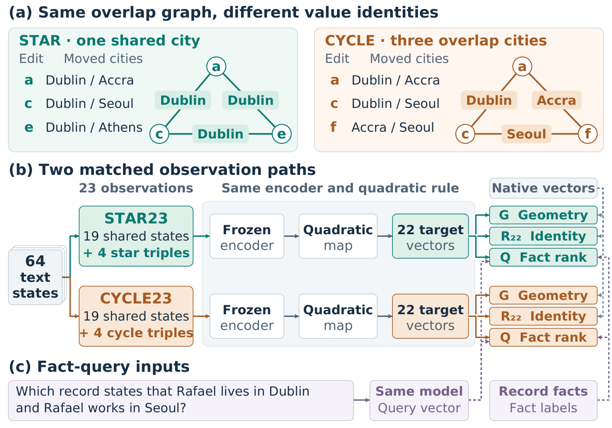

# Beyond Pairwise Overlap: Shared-Value Observations for Compositional Text Embeddings

**Wenzhang Du** · [Open Research Reports](https://dqswordman.github.io/open-research/) · November 2026

Which 23 of 64 directory versions should an encoder observe? On 2,048 synthetic worlds, observing edits that share one city reduced normalized reconstruction error by 53.4% for BGE and 36.0% for E5 on atomic text, compared with a cycle of pairwise city overlaps.

[Manuscript PDF](paper/manuscript.pdf) · [Technical report](https://dqswordman.github.io/technical-reports/shared-value-embeddings/) · [中文技术报告](https://dqswordman.github.io/zh/technical-reports/shared-value-embeddings/) · [Interactive explorer](https://huggingface.co/spaces/DQSWORDMAN/shared-value-embeddings) · [Download v1.0.1](https://github.com/dqswordman/shared-value-embeddings/releases/tag/v1.0.1)



## Read the evidence

Both designs use the same observation budget, target states and reconstruction rule. The difference is which triples of edits are observed. The tables report geometric error, identification of a directory version and retrieval of a requested fact separately. The Qwen check uses 512 preselected worlds from the original pool.

| Result | Open the evidence |
| --- | --- |
| Two-encoder comparison · Table 1 | [Frozen records](data/units.csv.xz) · [Analysis or reference](reference/primary_contrasts.csv) |
| Query strata and rankings | [Frozen records](data/query_strata_world.csv.xz) · [Analysis or reference](reference/query_strata.csv) |
| Qwen transfer check | [Frozen records](data/qwen/unit_results.csv.xz) · [Analysis or reference](reference/qwen/primary.csv) |

## Reproduce on CPU

From the extracted release, run the following with Python 3.12. Results go into an empty directory of your choice.

```sh
python -m pip install -r requirements.txt
python -B verify_manifest.py
python -B reproduce.py --out replay
```

For one worked example, run `python -B example.py`. The [reproduction guide](docs/reproduction.md) maps files to scientific claims. Both technical reports are available offline in [English](docs/report.en.md) and [中文](docs/report.zh.md).

## Method implementation

The [observation design](code/design_reference.py) defines which 23 states each plan sees. The [query code](code/query_reference.py) defines relevance for fact retrieval. Using the 2,048 paired worlds and the original 10,000 shared bootstrap draws, the [paired inference code](code/paired_intervals.py) reconstructs the eight primary contrasts and their simultaneous 95% intervals.

```sh
python -B check_methods.py
```

## Cite and reuse

Wenzhang Du (2026). *Beyond Pairwise Overlap: Shared-Value Observations for Compositional Text Embeddings*. Open Research Reports, v1.0.1. [Manuscript](https://dqswordman.github.io/assets/reports/shared-value-embeddings/manuscript.pdf). [Machine-readable citation](CITATION.cff) · [BibTeX](citation.bib)

Wenzhang Du is the sole author. The attached PDF preserves the supplied anonymous title page. Original software uses the [MIT License](LICENSE). The author’s original report, figures, constructed data and measurements use [CC BY 4.0](licenses/CC-BY-4.0.txt). Third-party material retains its own terms and attribution. [Source notices](THIRD_PARTY_NOTICES.md)
