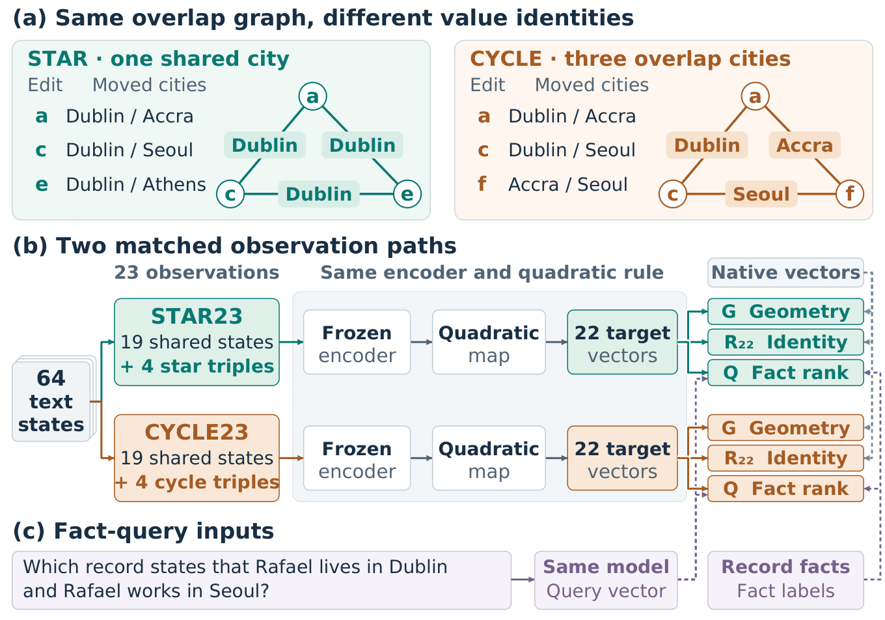

# Which 23 observations reveal an unseen embedding?

Beyond Pairwise Overlap: Shared-Value Observations for Compositional Text Embeddings

Wenzhang Du · Open Research Reports · v1.0.0 · 2026-11-21

Two sets of 23 observations see the same pairwise overlap pattern. Following the identity of the shared city changes how well they reconstruct a held-out directory.

[Original PDF](../paper/manuscript.pdf) · [Online report](https://dqswordman.github.io/technical-reports/shared-value-embeddings/)

## Follow the city shared by three edits

Imagine swapping Dublin with Accra in the residence field, Dublin with Seoul in the work field and Dublin with Athens in the study field. Every pair of swaps overlaps and Dublin belongs to all three. Change the last swap to Accra and Seoul. Every pair still overlaps, yet the three overlaps now refer to different cities. A graph recording only whether pairs meet draws the same triangle in both cases.



Figure 1 contrasts two edit triples with identical pairwise overlap and different shared-value structure.

## Spend the same observation budget

Six binary edits define 64 versions of each four-person directory. Star23 and Cycle23 encode 23 states each and use the same quadratic reconstruction rule for the remaining states. The experiment varies which joint edits are observed while keeping the number of observations, target states and decoder fixed. Two renderings express the same facts as atomic sentences or compressed prose.

The primary test uses 2,048 synthetic worlds with BGE-small and E5-small. Normalized mean squared error measures approximation in the native representation space. R22 asks whether the reconstructed embedding retrieves the exact state in a 22-state candidate gallery. Balanced query ranking asks whether the representation helps retrieve facts; it can move differently from either geometry measure.

## Reconstruction and exact-state retrieval

Star23 has lower reconstruction error in all four encoder–rendering combinations. Relative reductions on atomic text are 53.4% for BGE and 36.0% for E5. On compressed records, exact-state retrieval improves by 15.45 and 15.80 percentage points, respectively. In the separate Qwen3-Embedding-0.6B atomic-text comparison, 512 preselected worlds yield a 6.58% relative error reduction.

Manuscript Table 1. Each pair gives Star23 / Cycle23. R22 is a percentage.

| Encoder · text | NMSE | R22 (%) |
| --- | --- | --- |
| BGE · Atomic | 0.01238 / 0.02657 | 99.02 / 96.00 |
| BGE · Compressed | 0.31746 / 0.72291 | 93.55 / 78.10 |
| E5 · Atomic | 0.01514 / 0.02367 | 98.15 / 96.80 |
| E5 · Compressed | 0.29736 / 0.69517 | 93.63 / 77.83 |

[Source table](https://github.com/dqswordman/shared-value-embeddings/blob/v1.0.0/reference/primary_contrasts.csv)

## What happens when somebody asks a question?

On atomic BGE text, same-entity queries gain 0.12424 percentage points of nDCG@5 and different-entity queries lose 0.03569. Compressed E5 provides a sharper example: state identity improves by 15.80 points while balanced query ranking falls by 0.03542 percentage points. Choosing observations for an indexing task therefore requires specifying what users will retrieve.

The 23-state design, four-person directories and fixed checkpoints define this evidence. The Qwen comparison reuses a subset of the same world pool. Natural documents, larger edit systems and additional independent pools would test how far the shared-value pattern extends.

## Reconstruct the result on CPU

The CPU entry decodes frozen scalar measurements, averages six conditions within each world and verifies the eight primary contrasts. It also reconstructs the paired 512-world Qwen interval with the original 10,000 draws. The archive includes synthetic inputs, observation designs, calibration choices and worked ranking records. Encoding new text requires the upstream encoders.

```sh
python -B verify_manifest.py
python -B reproduce.py --out replay
```

## Citation and materials

[Original manuscript · PDF](https://dqswordman.github.io/assets/reports/shared-value-embeddings/manuscript.pdf) · [Frozen release and checksums](https://github.com/dqswordman/shared-value-embeddings/releases/tag/v1.0.0) · [Result map and reproduction scope](https://github.com/dqswordman/shared-value-embeddings/blob/v1.0.0/docs/reproduction.md) · [Interactive evidence explorer](https://huggingface.co/spaces/DQSWORDMAN/shared-value-embeddings)
