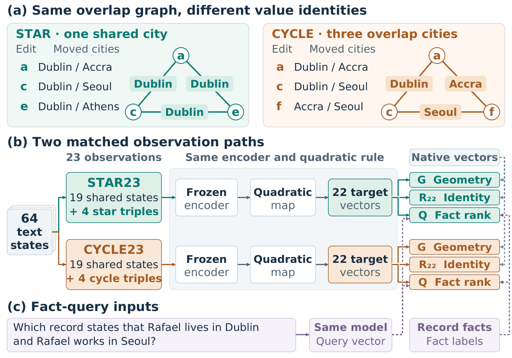

# 哪 23 个观测最能还原未见文本的嵌入？

Beyond Pairwise Overlap: Shared-Value Observations for Compositional Text Embeddings

Wenzhang Du · 开放研究报告 · v1.0.0 · 2026-11-21

两种方案各观察 23 个状态，编辑之间的两两重叠图相同。追踪重叠处是否指向同一座城市，会改变未见名录的嵌入重建误差。

[原版 PDF](../paper/manuscript.pdf) · [在线报告](https://dqswordman.github.io/zh/technical-reports/shared-value-embeddings/)

## 看三次编辑是否碰到同一座城市

设想把居住地里的都柏林与阿克拉互换，把工作地里的都柏林与首尔互换，再把求学地里的都柏林与雅典互换。每两次编辑都有交集，三次都涉及都柏林。现在把最后一次改为交换阿克拉与首尔，两两交集仍然存在，三个交点却分别指向不同城市。只标记两次编辑是否相交，得到的都是三角形。



图 1 展示两组编辑，具有相同的两两重叠图，但共享值结构不同。

## 让两种方案使用相同的观测预算

四人名录上的六个二元编辑产生 64 个状态。Star23 和 Cycle23 各编码 23 个状态，均用同一二次重建规则推算其他状态。实验改变联合观测的选择，同时固定观测数、目标状态和解码器。两种文本形式分别以原子句和压缩语句表述同一组事实。

主测试在 2,048 个合成世界上使用 BGE-small 和 E5-small。归一化均方误差衡量向量空间中的近似质量。R22 检查重建向量能否在 22 个候选状态中找回正确状态。平衡查询排序另行衡量能否检索到所需事实，它的变化方向可以与几何指标不同。

## 重建误差与完整状态检索

四个编码器与文本形式组合中，Star23 的重建误差均较低。原子文本上，BGE 和 E5 的相对误差分别下降 53.4% 和 36.0%。压缩文本上，完整状态检索分别提升 15.45 和 15.80 个百分点。另用 Qwen3-Embedding-0.6B 对预选的 512 个世界测试，原子文本上的相对误差下降 6.58%。

原稿表 1。每格依次为 Star23 / Cycle23，R22 单位为百分比。

| 编码器与文本 | 归一化误差 | 状态检索率 (%) |
| --- | --- | --- |
| BGE · Atomic | 0.01238 / 0.02657 | 99.02 / 96.00 |
| BGE · Compressed | 0.31746 / 0.72291 | 93.55 / 78.10 |
| E5 · Atomic | 0.01514 / 0.02367 | 98.15 / 96.80 |
| E5 · Compressed | 0.29736 / 0.69517 | 93.63 / 77.83 |

[数据来源](https://github.com/dqswordman/shared-value-embeddings/blob/v1.0.0/reference/primary_contrasts.csv)

## 查询目标会怎样改变判断？

在 BGE 原子文本上，同实体查询的 nDCG@5 增加 0.12424 个百分点，跨实体查询下降 0.03569 个百分点。E5 压缩文本的对照更鲜明：状态检索提升 15.80 点，平衡查询排序却下降 0.03542 个百分点。为索引选择观测状态之前，需要明确用户实际要检索什么。

证据来自固定检查点、四人名录和特定的 23 状态方案。Qwen 比较沿用了原测试池的子集。自然文档、更大的编辑空间及独立世界池将检验这一规律的外推范围。

## 用 CPU 重建结果

CPU 入口解码冻结的标量，先在每个世界内平均六个条件，再核验八项主比较，并以原来的 10,000 次配对抽样恢复 Qwen 的 512 世界区间。包内提供合成输入、观测方案、校准选择和排序实例。编码新的文本需要另外取得上游编码器。

```sh
python -B verify_manifest.py
python -B reproduce.py --out replay
```

## 引用与材料

[原版论文 · PDF](https://dqswordman.github.io/assets/reports/shared-value-embeddings/manuscript.pdf) · [固定版本与校验值](https://github.com/dqswordman/shared-value-embeddings/releases/tag/v1.0.0) · [结果映射与复现范围](https://github.com/dqswordman/shared-value-embeddings/blob/v1.0.0/docs/reproduction.md) · [交互式证据浏览](https://huggingface.co/spaces/DQSWORDMAN/shared-value-embeddings)
